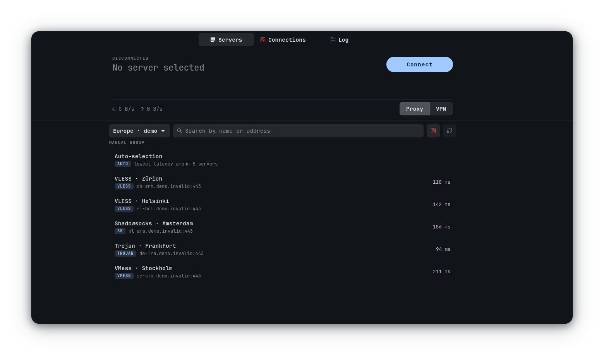
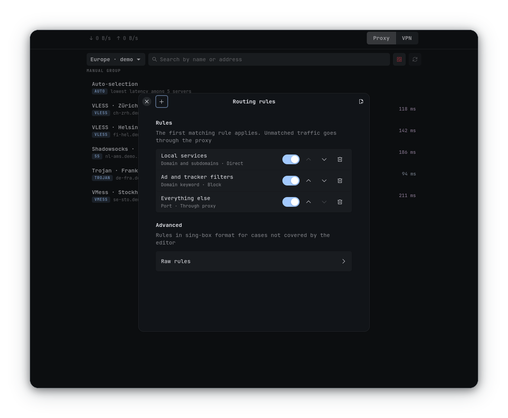
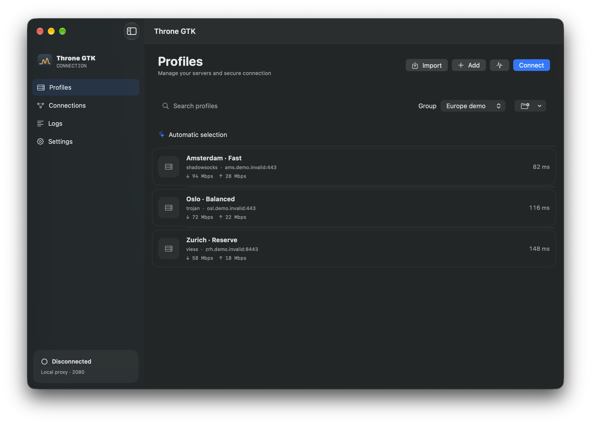
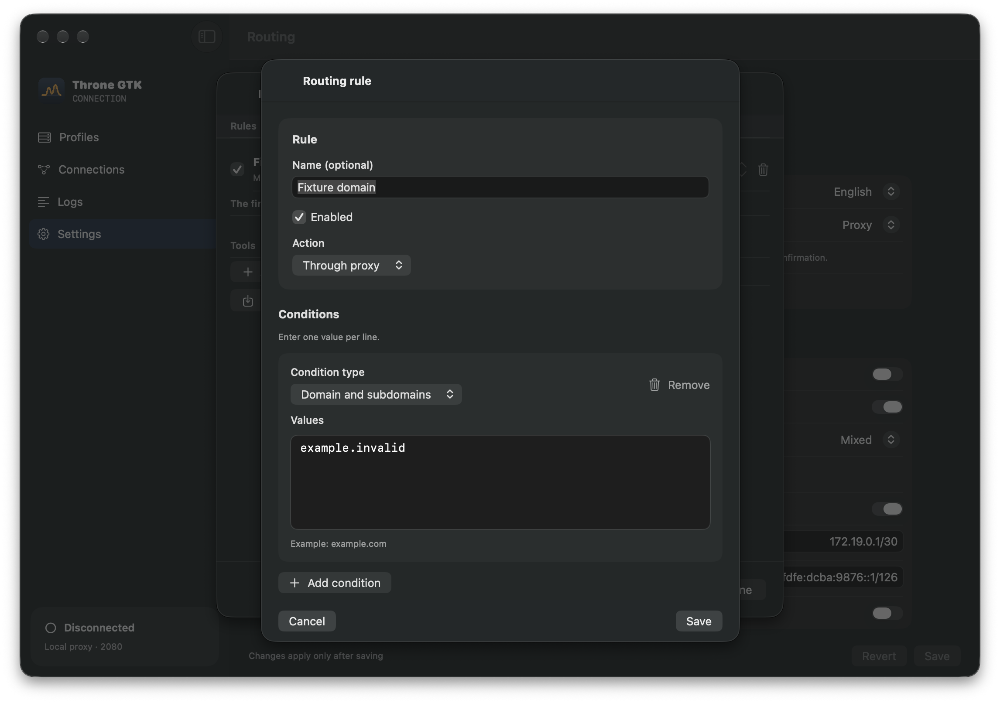

<div align="center">


# Throne GTK

**A desktop proxy client with a native feel.**

SwiftUI & AppKit on macOS. GTK4 & libadwaita on Linux and Windows. Powered by sing-box and Xray.

[](LICENSE)
[](#platforms)

**English** · [Русский](README.ru.md)

[Download](https://github.com/nalart11/Throne-GTK/releases) · [Build from source](#build-from-source) · [Report an issue](https://github.com/nalart11/Throne-GTK/issues)

</div>

---

Throne GTK is an independent desktop project originally based on [Throne](https://github.com/throneproj/Throne). It has its own Rust application layer and native interfaces, with networking powered by a Go core built on sing-box and Xray. The project develops its own interface, configuration, storage, and desktop integration rather than retaining the original Qt application.

Use it as a local proxy or route traffic through a TUN-based VPN. Manage subscriptions, choose servers, configure DNS-over-HTTPS or DNS-over-TLS, and keep routing rules in one application.

## Interface

### Linux · GTK4 / libadwaita

**Profiles and groups**



**Routing rules**



*Captured on Linux with the desktop's GTK styling. Fonts, icons, and colors may vary with your theme.*

### macOS · SwiftUI / AppKit

**Profiles and groups**



**Routing rule editor**



*All screenshots use demonstration data; no live VPN connection is shown. macOS has a separate native interface; Linux and Windows use GTK.*

## Features

- **Proxy or VPN.** Run a local proxy or use a TUN interface for system traffic.
- **Profiles and subscriptions.** Import server links, Base64 subscriptions, Clash YAML, and sing-box JSON; organize profiles into groups.
- **Protocol support.** VLESS/Reality/XTLS Vision, VMess, Trojan, Shadowsocks, Hysteria2, TUIC, AnyTLS, Naive, SOCKS, and HTTP. XHTTP profiles use Xray; other supported profiles use sing-box.
- **Automatic server selection.** Select the best available server in a group, pin a server, or request a recheck.
- **Connection diagnostics.** Batch latency checks, individual speed tests, logs, traffic statistics, and active connections.
- **Routing you control.** Ordered rules with proxy, direct, and block actions; combine conditions with any/all matching. Match domains, IP ranges, ports, processes, and supported rule sets.
- **DNS-over-HTTPS and DNS-over-TLS.** Send DNS queries over HTTPS or TLS instead of unencrypted DNS, with configurable resolvers and separate proxy and direct paths.
- **Desktop integration.** Light/dark appearance, Russian and English, native macOS menus and status item, and a Linux status icon where supported.
- **Migration from Throne.** Import profiles, subscriptions, and supported routing rules—or import only the routing rules.

## Platforms

| Platform | Interface | Notes |
| --- | --- | --- |
| macOS | SwiftUI / AppKit | No GTK or Homebrew runtime required by the packaged app. VPN uses a separate privileged helper. |
| Linux | GTK4 / libadwaita | VPN requires TUN capabilities. Tray support depends on a StatusNotifierItem host. |
| Windows | GTK4 / libadwaita | Current source-build instructions use MSYS2 MinGW64. VPN requires administrator privileges; tray support is disabled. |

**This project is under active development.** The native frontend targets macOS 13+, but the actual app minimum is the higher deployment target of its GUI and core. The current packaged core requires **macOS 27.0**; check the requirements of the package you use.

## Installation

### macOS

See [Releases](https://github.com/nalart11/Throne-GTK/releases) for available packages. The published v0.1.0 asset is a local-use **PKG installer**, not a Developer ID–signed/notarized public distribution. Only install a package whose source you trust; do not disable system-wide security protections. README screenshots may show development changes newer than that release.

For a build from this checkout:

```sh
just dmg          # dist/throne-gtk-macos.dmg
# Or, for a trusted personal installation with a system helper:
just installer    # dist/throne-gtk-local-installer.pkg
```

The DMG contains `Throne GTK.app` for local proxy use. VPN requires a PKG installation of the complete bundle into the protected `/Library/Application Support/Throne GTK/Throne GTK.app`; `/Applications` contains only a link. Copying the DMG app into `/Applications` does not grant VPN privileges. Do not weaken global directory permissions to bypass the checks. Close the application before updating.

The local installer requests administrator authorization and registers a manual launchd helper. It is for a trusted personal Mac, not notarized public distribution. For a signed PKG using SMAppService, use `just installer-release` with `CODESIGN_IDENTITY`, `INSTALLER_SIGN_IDENTITY`, and `NOTARY_PROFILE`. The existence of these commands does not establish that signing or notarization succeeded. Installation, migration, removal, and outstanding native checks are described in the [macOS handoff](docs/MACOS_HANDOFF.md) and [helper policy](core/helpertrust/README.md).

The privileged macOS worker accepts only an explicitly allowed configuration schema; arbitrary extensions and non-VLESS native Xray profiles are rejected. The unprivileged core retains its normal configuration surface.

On the Service Management installation path, macOS may require approval in **System Settings → General → Login Items & Extensions**. The GUI and normal proxy mode run as your user; only the separate VPN core receives elevated privileges.

> **VPN and development builds:** launch the installed app, not a loose GUI binary from `build/` or `native/macos/.build/`. The running helper authenticates the GUI and expects it beside its core. Updating an app does not necessarily restart an already-running helper.

### Linux

Build from source, then install for your user:

```sh
just install
just grant-tun    # Only needed for VPN; grants capabilities to the core
```

The default installation prefix is `~/.local`. Repeat `just grant-tun` after reinstalling the core. Proxy mode does not need these capabilities. To remove the application, run `just uninstall`.

### Windows

Build using the MSYS2 instructions below. The GTK/libadwaita DLLs must be available at runtime. No Windows installer is promised by the current release.

## Build from source

Common prerequisites: **Rust, Go, Protocol Buffers (`protoc`), and [`just`](https://github.com/casey/just)**. Linux/Windows additionally need **GTK ≥ 4.12** and **libadwaita ≥ 1.5**. macOS uses the Swift/Xcode toolchain instead of GTK.

```sh
git clone https://github.com/nalart11/Throne-GTK.git
cd Throne-GTK
RELEASE=1 just build
```

The build places `throne-gtk` and `throne-gtk-core` in `build/` (`.exe` on Windows). Keep them together and retain their names: the core verifies the GUI's identity and location. The build tasks also handle Cronet where available for Naive support.

The Justfile selects **Go 1.26.0** via `GOTOOLCHAIN` as a compatibility workaround for dependencies that use Go linker internals. Allow Go's toolchain download or install that version explicitly; do not assume a newer Go version is interchangeable.

<details>
<summary><strong>Linux · Debian / Ubuntu prerequisites</strong></summary>

```sh
sudo apt install build-essential libgtk-4-dev libadwaita-1-dev protobuf-compiler just
RELEASE=1 just build
```

Install Rust and Go separately. Your distribution must provide the minimum GTK/libadwaita versions above; older distribution releases may not.

</details>

<details>
<summary><strong>macOS prerequisites</strong></summary>

```sh
xcode-select --install
brew install protobuf just
RELEASE=1 just build
```

Install Rust and Go separately. `just build-app` selects SwiftUI/AppKit on Darwin. Cronet is linked statically on macOS; the packaged application does not need Homebrew GTK libraries.

For Developer ID signing and notarization, configure your signing identity and a Keychain `notarytool` profile, then use:

```sh
CODESIGN_IDENTITY="Developer ID Application: Your Name (TEAMID)" \
NOTARY_PROFILE=throne-notary just dmg
```

Without these credentials, local packaging uses ad-hoc signing. See the [native macOS guide](native/macos/README.md) for isolated build commands and limitations.

</details>

<details>
<summary><strong>Windows · MSYS2 MinGW 64-bit</strong></summary>

Run in the **MSYS2 MinGW 64-bit** terminal with Rust's GNU toolchain:

```sh
pacman -S --needed mingw-w64-x86_64-gcc \
  mingw-w64-x86_64-gtk4 mingw-w64-x86_64-libadwaita \
  mingw-w64-x86_64-pkgconf mingw-w64-x86_64-protobuf \
  mingw-w64-x86_64-just
rustup toolchain install stable-x86_64-pc-windows-gnu
rustup default stable-x86_64-pc-windows-gnu
RELEASE=1 just build
```

Install Go separately and keep `C:\msys64\mingw64\bin` in `PATH` when running the app. VPN mode needs administrator privileges. With no Windows tray implementation, closing the window exits the application.

</details>

### Development checks

```sh
just run-app     # Run the development build
just test        # Project test tasks
# macOS bridge + frontend checks using temporary data, without connecting:
bash native/macos/verify-frontend.sh
```

`just selftest` is a separate real-data/core validation tool, not a migration command or an isolated unit test. Review its implementation and options before using it. Native validation commands, results, and unverified behavior are recorded in [VERIFICATION.md](native/macos/VERIFICATION.md).

## Getting started

1. Add a server link/subscription, or import an existing Throne database.
2. Select a group and profile, or choose automatic selection for a populated group.
3. Choose **Proxy** or **VPN** and configure routing/DNS as needed.
4. Connect. Disconnect before changing installation or privilege configuration.

Saved connection settings apply on the next connection. The interface supports English and Russian. The macOS interface updates after saving the language; GTK requires a full restart, not just closing its window to the tray. Engine diagnostics may also require a restart.

### DNS in VPN mode

macOS may show `172.19.0.2` as its DNS server while connected. This is Throne GTK's **internal tunnel resolver**, not the external upstream. With the built-in DNS service enabled, set **Settings → DNS → Remote resolver** to an upstream such as `https://1.1.1.1/dns-query` for Cloudflare DoH through the proxy. The direct resolver is a separate path; changing it is not the same as changing the proxy resolver. Save and reconnect to apply changes.

### Importing from Throne

The macOS **Import** picker accepts the original Throne SQLite database. For routing rules alone, use the import action in the routing editor; a full database import also adds profiles/groups and can create duplicates if repeated.

One macOS location used by the original app is:

```text
~/Library/Preferences/Throne/config/throne.db
```

Locations depend on the original installation. In a macOS file picker, press **⌘⇧G** to enter a path. If the database has `-wal`/`-shm` sidecars, do not copy only the `.db` file from a live database. Keep the source intact and make a consistent backup before migration.

The importer leaves the source database unchanged. Only supported routing conditions/actions are transferred; review the skipped-rule count, rule order, and actions before reconnecting. Route-only import reads the active routing profile from the original database.

## Data and privacy

| Platform | Profiles, settings, and core cache |
| --- | --- |
| Linux | `~/.config/throne-gtk/` |
| macOS | `~/Library/Application Support/throne-gtk/` |
| Windows | `%APPDATA%\throne-gtk\` |

The main database is `throne-gtk.db`; the core cache is `cache.db`. Do not open the same database in multiple app instances. Databases and exported profiles can contain credentials: keep backups private and redact secrets from bug reports, logs, and screenshots.

## Known limitations

- Not every original Throne feature is implemented: proxy chains, Tailscale/SSH outbounds, and an embedded Clash panel are not supported.
- Exposed subscription auto-update preferences do not currently imply a working background scheduler.
- macOS VPN changes system networking. The current core resets DNS to automatic on normal stop rather than restoring a previously configured custom DNS list; interrupted cleanup can require attention. Do not assume a crash restores network settings.
- Package availability, code signing, and operating-system requirements vary by release; check the accompanying release notes.

## Project structure

```text
native/macos/          SwiftUI/AppKit interface
crates/macos-bridge/   In-process Rust static library and C ABI
crates/app/            GTK interface and shared engine modules
crates/config/         Settings, imports, and configuration generation
crates/store/          SQLite persistence and legacy database import
crates/ipc/            Protobuf IPC and core supervision
core/                 Go core: sing-box and Xray
```

The GUI and core communicate over a Unix socket or Windows named pipe. macOS reuses Rust storage/configuration/IPC in-process; it does not introduce another backend daemon. The privileged helper is separate and used for VPN.

## Contributing

Bug reports, focused fixes, platform testing, and translation improvements are welcome. [Open an issue](https://github.com/nalart11/Throne-GTK/issues) with your OS, app version or commit, reproduction steps, and sanitized logs. For UI changes, include a screenshot without personal profiles or credentials. Mention which checks you ran and which platforms you could not test.

## Credits and license

Originally based on [Throne](https://github.com/throneproj/Throne). Thanks to the projects that make Throne GTK possible: [sing-box](https://github.com/SagerNet/sing-box), [Xray-core](https://github.com/XTLS/Xray-core), [GTK](https://www.gtk.org/), [libadwaita](https://gnome.pages.gitlab.gnome.org/libadwaita/), and Apple's SwiftUI/AppKit.

Licensed under **GPL-3.0-or-later**. See [LICENSE](LICENSE). Dependencies retain their respective licenses.
