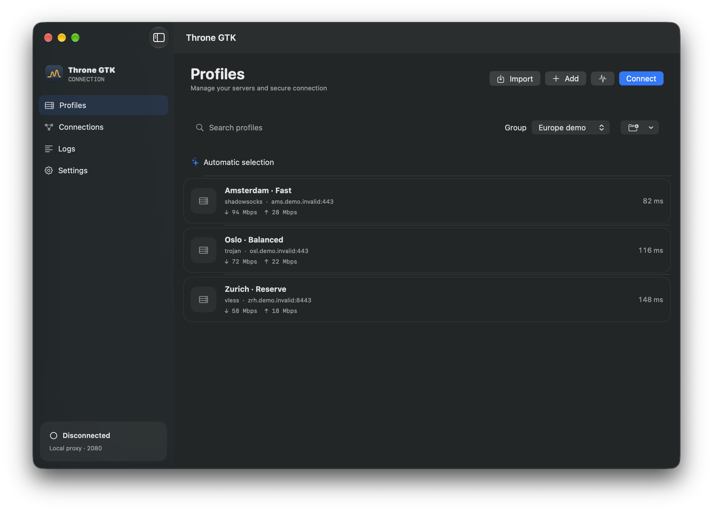
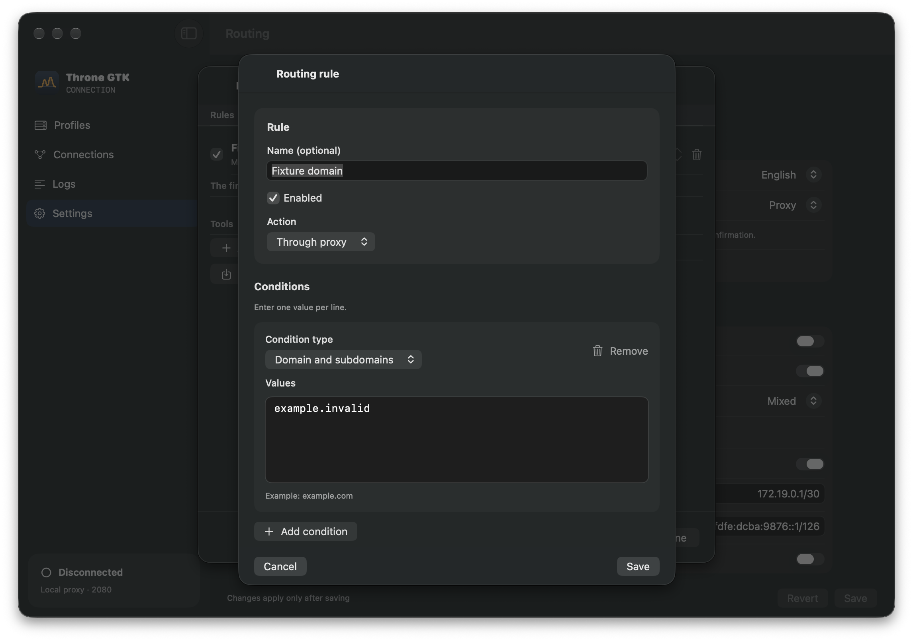

<div align="center">


# Throne GTK

**Десктопный прокси-клиент с нативным интерфейсом.**

SwiftUI и AppKit на macOS. GTK4 и libadwaita на Linux и Windows. Ядро — sing-box и Xray.

[](LICENSE)
[](#платформы)

[English](README.md) · **Русский**

[Скачать](https://github.com/nalart11/Throne-GTK/releases) · [Сборка из исходников](#сборка-из-исходников) · [Сообщить об ошибке](https://github.com/nalart11/Throne-GTK/issues)

</div>

---

Throne GTK — самостоятельный десктопный проект, изначально основанный на [Throne](https://github.com/throneproj/Throne). У него собственная прикладная часть на Rust и нативные интерфейсы, а сетевые функции выполняет Go-ядро на базе sing-box и Xray. Проект развивает собственные интерфейс, конфигурацию, хранение данных и интеграцию с рабочим столом вместо сохранения исходного Qt-приложения.

Работайте через локальный прокси или направляйте трафик в VPN через TUN. Подписки, выбор серверов, DNS-over-HTTPS и DNS-over-TLS, а также правила маршрутизации собраны в одном приложении.

## Интерфейс

### Профили и группы



### Редактор правил маршрутизации



*Скриншоты macOS с демонстрационными данными, без активного VPN-подключения. В Linux и Windows используется отдельный GTK-интерфейс.*

## Возможности

- **Прокси или VPN.** Локальный прокси либо TUN-интерфейс для системного трафика.
- **Профили и подписки.** Импорт ссылок, Base64-подписок, Clash YAML и JSON sing-box; организация серверов по группам.
- **Протоколы.** VLESS/Reality/XTLS Vision, VMess, Trojan, Shadowsocks, Hysteria2, TUIC, AnyTLS, Naive, SOCKS и HTTP. Профили XHTTP работают через Xray, остальные поддерживаемые профили — через sing-box.
- **Автовыбор сервера.** Выбор доступного сервера в группе, закрепление сервера и принудительная перепроверка.
- **Диагностика.** Пакетная проверка задержки, замер скорости отдельного сервера, журнал, статистика трафика и активные соединения.
- **Управляемая маршрутизация.** Упорядоченные правила «Прокси», «Напрямую» и «Блокировать», объединение условий через «любое» или «все». Домены, подсети, порты, процессы и поддерживаемые наборы правил.
- **DNS-over-HTTPS и DNS-over-TLS.** Передача DNS-запросов через HTTPS или TLS вместо обычного незашифрованного DNS; выбор серверов и отдельных направлений через прокси и напрямую.
- **Интеграция с рабочим столом.** Светлая и тёмная темы, русский и английский языки, нативные меню и значок macOS, трей Linux при поддержке окружением.
- **Перенос из Throne.** Импорт профилей, подписок и поддерживаемых правил — либо только правил маршрутизации.

## Платформы

| Платформа | Интерфейс | Особенности |
| --- | --- | --- |
| macOS | SwiftUI / AppKit | Упакованное приложение не требует GTK или Homebrew. Для VPN используется отдельный привилегированный helper. |
| Linux | GTK4 / libadwaita | Для VPN нужны права на TUN. Трей зависит от наличия хоста StatusNotifierItem. |
| Windows | GTK4 / libadwaita | Инструкция сборки рассчитана на MSYS2 MinGW64. VPN требует прав администратора; трей отключён. |

**Проект активно развивается.** Нативный frontend нацелен на macOS 13+, но реальный минимум приложения определяется наиболее высоким deployment target интерфейса и ядра. Ядро в текущей упакованной сборке требует **macOS 27.0**; смотрите требования конкретного пакета.

## Установка

### macOS

Доступные пакеты находятся в [релизах](https://github.com/nalart11/Throne-GTK/releases). В опубликованном v0.1.0 есть **PKG для личной установки**, а не публичный дистрибутив с подписью Developer ID и нотариализацией. Устанавливайте только пакет из доверенного источника; не отключайте системную защиту целиком. Скриншоты в README могут показывать изменения, которых ещё нет в этом релизе.

Из текущих исходников можно собрать:

```sh
just dmg          # dist/throne-gtk-macos.dmg
# Или установщик для собственного доверенного Mac с системным helper:
just installer    # dist/throne-gtk-local-installer.pkg
```

В DMG находится `Throne GTK.app`. Для VPN перенесите его в `/Applications`. Локальный установщик запрашивает авторизацию администратора и устанавливает/регистрирует helper. Перед обновлением полностью закройте приложение. Эти варианты не следует путать с нотариализованным релизом.

При регистрации через Service Management macOS может потребовать разрешение в **Системные настройки → Основные → Объекты входа и расширения**. GUI и обычный прокси работают от пользователя; повышенные права получает только отдельное ядро VPN.

> **VPN при разработке:** запускайте установленное приложение, а не отдельный GUI из `build/` или `native/macos/.build/`. Работающий helper проверяет GUI и ожидает его рядом со своим ядром. Замена `.app` не обязательно перезапускает уже работающий helper.

### Linux

После сборки установите приложение для текущего пользователя:

```sh
just install
just grant-tun    # Только для VPN: выдаёт ядру необходимые capabilities
```

Префикс установки по умолчанию — `~/.local`. После переустановки ядра повторите `just grant-tun`. Для режима прокси эти права не нужны. Удаление: `just uninstall`.

### Windows

Используйте инструкцию сборки MSYS2 ниже. При запуске должны быть доступны DLL GTK/libadwaita. Наличие установщика Windows в текущем релизе не заявляется.

## Сборка из исходников

Общие зависимости: **Rust, Go, Protocol Buffers (`protoc`) и [`just`](https://github.com/casey/just)**. Linux/Windows также нужны **GTK ≥ 4.12** и **libadwaita ≥ 1.5**. На macOS вместо GTK используется Swift/Xcode.

```sh
git clone https://github.com/nalart11/Throne-GTK.git
cd Throne-GTK
RELEASE=1 just build
```

Результат — `throne-gtk` и `throne-gtk-core` в `build/` (на Windows — `.exe`). Сохраняйте имена файлов и держите их рядом: ядро проверяет имя и расположение GUI. Задачи сборки также подготавливают Cronet для Naive там, где он доступен.

Justfile выбирает **Go 1.26.0** через `GOTOOLCHAIN`: это обход несовместимости зависимостей, использующих внутренние механизмы линковщика Go. Разрешите автоматическую загрузку toolchain или установите нужную версию явно; более новая Go не обязательно взаимозаменяема.

<details>
<summary><strong>Linux · зависимости Debian / Ubuntu</strong></summary>

```sh
sudo apt install build-essential libgtk-4-dev libadwaita-1-dev protobuf-compiler just
RELEASE=1 just build
```

Rust и Go установите отдельно. Версии GTK/libadwaita в дистрибутиве должны соответствовать минимуму выше; старые выпуски могут не подходить.

</details>

<details>
<summary><strong>macOS · зависимости</strong></summary>

```sh
xcode-select --install
brew install protobuf just
RELEASE=1 just build
```

Rust и Go установите отдельно. `just build-app` выбирает SwiftUI/AppKit на Darwin. Cronet линкуется статически; готовому приложению не нужны библиотеки GTK из Homebrew.

Для подписи Developer ID и нотариализации подготовьте сертификат и профиль `notarytool` в Keychain:

```sh
CODESIGN_IDENTITY="Developer ID Application: Your Name (TEAMID)" \
NOTARY_PROFILE=throne-notary just dmg
```

Без этих данных локальная упаковка использует ad-hoc подпись. Изолированные команды сборки и ограничения описаны в [руководстве нативной версии](native/macos/README.md).

</details>

<details>
<summary><strong>Windows · MSYS2 MinGW 64-bit</strong></summary>

Запускайте команды в терминале **MSYS2 MinGW 64-bit** с GNU-вариантом Rust:

```sh
pacman -S --needed mingw-w64-x86_64-gcc \
  mingw-w64-x86_64-gtk4 mingw-w64-x86_64-libadwaita \
  mingw-w64-x86_64-pkgconf mingw-w64-x86_64-protobuf \
  mingw-w64-x86_64-just
rustup toolchain install stable-x86_64-pc-windows-gnu
rustup default stable-x86_64-pc-windows-gnu
RELEASE=1 just build
```

Go установите отдельно. При запуске добавьте `C:\msys64\mingw64\bin` в `PATH`. VPN требует прав администратора. Поскольку трей Windows не реализован, закрытие окна завершает приложение.

</details>

### Проверки для разработки

```sh
just run-app     # Запуск отладочной сборки
just test        # Тестовые задачи проекта
# macOS: проверки моста и frontend на временных данных, без подключения:
bash native/macos/verify-frontend.sh
```

`just selftest` — отдельная проверка реальных данных и ядра, а не команда переноса базы и не изолированный unit-тест. Перед запуском изучите её реализацию и параметры. Команды, результаты и ограничения проверки macOS записаны в [VERIFICATION.md](native/macos/VERIFICATION.md).

## Первый запуск

1. Добавьте ссылку на сервер/подписку или импортируйте базу Throne.
2. Выберите группу и профиль либо автовыбор в заполненной группе.
3. Выберите режим **Прокси** или **VPN**, настройте маршрутизацию и DNS.
4. Подключитесь. Перед изменением установки или прав сначала отключайтесь.

Настройки соединения применяются при следующем подключении. Интерфейс доступен на русском и английском. В macOS язык обновляется после сохранения, в GTK нужен полный перезапуск — закрыть окно в трей недостаточно. Для языка диагностических сообщений engine тоже может потребоваться перезапуск.

### DNS в режиме VPN

Во время подключения macOS может показывать DNS `172.19.0.2`. Это **внутренний DNS туннеля**, а не внешний сервер. При включённой встроенной службе DNS задайте в **Настройки → DNS → Через прокси**, например, `https://1.1.1.1/dns-query` для Cloudflare DoH через прокси. Поле «Напрямую» задаёт отдельное направление и не заменяет проксируемый DNS. Сохраните настройки и переподключитесь.

### Импорт из Throne

Кнопка **Импорт** на macOS открывает выбор исходной SQLite-базы Throne. Для переноса только правил используйте импорт в редакторе маршрутизации: полный импорт также добавляет профили/группы, а повторный запуск может создать дубликаты.

Один из путей оригинального приложения на macOS:

```text
~/Library/Preferences/Throne/config/throne.db
```

Путь зависит от установки оригинала. В диалоге выбора файла нажмите **⌘⇧G**, чтобы вставить адрес. Если рядом есть `-wal`/`-shm`, не копируйте отдельно `.db` из работающей базы. Сохраняйте исходные файлы вместе и перед переносом делайте согласованную резервную копию.

Импорт не меняет исходную базу. Переносятся только поддерживаемые условия и действия; перед переподключением проверьте счётчик пропущенных правил, порядок и действия. Отдельный импорт правил читает активный профиль маршрутизации оригинальной базы.

## Данные и конфиденциальность

| Платформа | Профили, настройки и кэш ядра |
| --- | --- |
| Linux | `~/.config/throne-gtk/` |
| macOS | `~/Library/Application Support/throne-gtk/` |
| Windows | `%APPDATA%\throne-gtk\` |

Основная база — `throne-gtk.db`, кэш ядра — `cache.db`. Не открывайте одну базу несколькими экземплярами приложения. Базы и экспортированные профили могут содержать пароли: храните копии приватно и удаляйте секреты из отчётов, логов и скриншотов.

## Известные ограничения

- Не все функции оригинального Throne перенесены: цепочки прокси, Tailscale/SSH-выхлопы и встроенная панель Clash не поддерживаются.
- Наличие настроек автоматического обновления подписок пока не означает работу фонового планировщика.
- VPN на macOS меняет системные сетевые настройки. Текущее ядро при штатной остановке сбрасывает DNS на автоматический, а не восстанавливает ранее заданный список. При прерванной очистке может потребоваться вмешательство; не рассчитывайте, что аварийный выход автоматически восстановит сеть.
- Доступность пакетов, подпись и требования к ОС зависят от релиза; сверяйтесь с примечаниями к нему.

## Структура проекта

```text
native/macos/          Интерфейс SwiftUI/AppKit
crates/macos-bridge/   Rust staticlib и C ABI внутри процесса
crates/app/            GTK-интерфейс и общие модули engine
crates/config/         Настройки, импорт и генерация конфигурации
crates/store/          SQLite и импорт старых баз
crates/ipc/            Protobuf IPC и управление ядром
core/                 Go-ядро: sing-box и Xray
```

GUI и ядро общаются через Unix-сокет или Windows named pipe. На macOS Rust-хранилище, конфигурация и IPC переиспользуются внутри процесса, без дополнительного backend-демона. Привилегированный helper — отдельный компонент для VPN.

## Участие в разработке

Приветствуются отчёты об ошибках, небольшие исправления, тестирование платформ и улучшения переводов. В [issue](https://github.com/nalart11/Throne-GTK/issues) укажите ОС, версию/коммит, шаги воспроизведения и очищенные от секретов логи. Для ошибок GUI приложите скриншот без личных профилей и паролей. Напишите, какие проверки выполнены и какие платформы проверить не удалось.

## Благодарности и лицензия

Изначально проект был основан на [Throne](https://github.com/throneproj/Throne). Благодарности проектам, благодаря которым работает Throne GTK: [sing-box](https://github.com/SagerNet/sing-box), [Xray-core](https://github.com/XTLS/Xray-core), [GTK](https://www.gtk.org/), [libadwaita](https://gnome.pages.gitlab.gnome.org/libadwaita/) и Apple SwiftUI/AppKit.

Лицензия — **GPL-3.0-or-later**. См. [LICENSE](LICENSE). Зависимости распространяются на условиях собственных лицензий.
